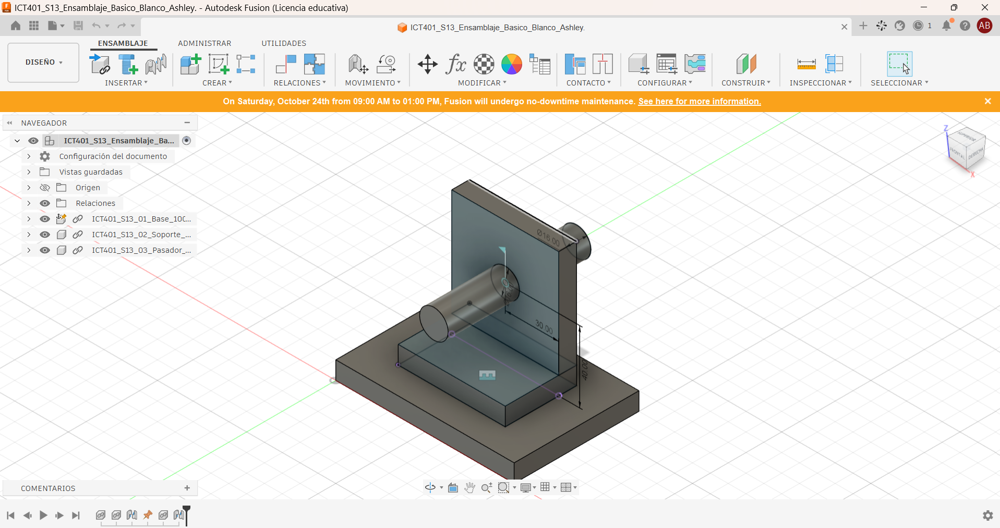
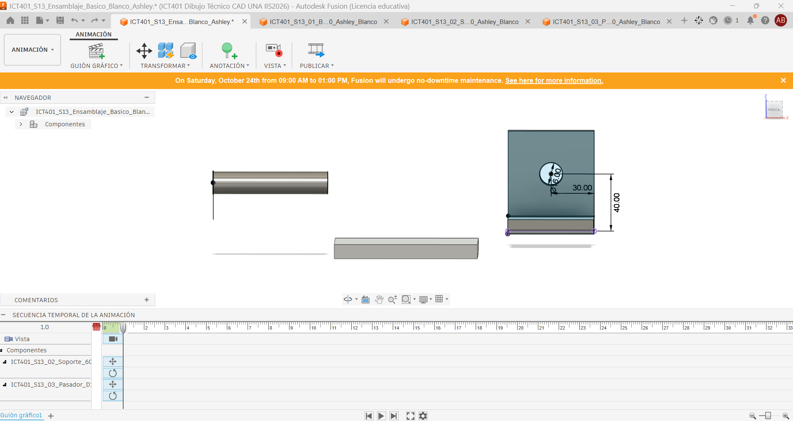
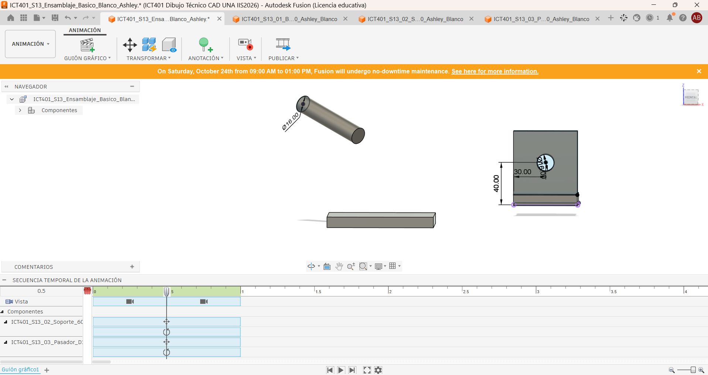
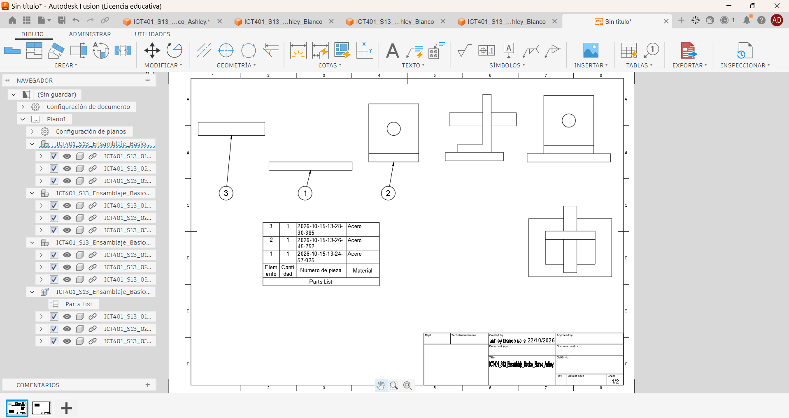
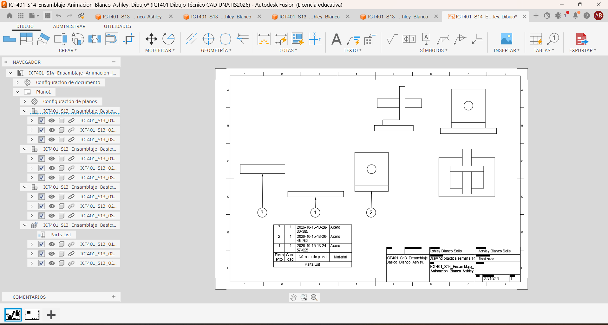

# Ficha de registro: Semana 14

**Curso:** ICT401 – Dibujo Técnico Asistido por Computadora
**Semana:** 14
**Tema:** Vista explosionada, lista de componentes y documentación de conjuntos
**Estudiante:** Blanco Ashley
**Fecha:** 22 de octubre de 2026
**Archivo o enlace del conjunto:** `ruta/al/archivo-o-enlace`

## Propósito

Esta ficha registra las decisiones, comprobaciones, dificultades y evidencias de la documentación del conjunto. Se trabaja con el ensamblaje validado en la Semana 13. No sustituye la rúbrica oficial de la Fase 3 ni la Prueba Corta 3.

## Criterios normativos de revisión

La aplicación de estas normas es didáctica y selectiva; no constituye una certificación integral de conformidad normativa. Registre la evidencia o la limitación encontrada.

| Referencia | Criterio que se aplica | Evidencia o limitación registrada |
|---|---|---|
| INTE/ISO 128-1:2024 | La vista comunica el conjunto sin ambigüedad y conserva la identidad de sus componentes. |  La vista explosionada muestra cada componente sin ambigüedad, se distinguen piezas y mantiene identidad. |
| INTE/ISO 128-2:2023 | Contornos, ejes, líneas ocultas y líneas de trayectoria se distinguen; las trayectorias no sustituyen los contornos. | Los contornos y ejes se diferencian de las trayectorias; las líneas de explosión no sustituyen contornos. |
| INTE/ISO 128-3:2025 / ISO 5456-2 | La orientación, las vistas y el método de proyección son coherentes. | Se usó proyección de primer diedro europeo, coherente con las vistas. |
| ISO 5457 | La hoja, orientación, escala y distribución permiten leer la documentación. |Hoja en formato A3, escala legible, distribución clara.  |
| INTE/ISO 7200:2008 | El cajetín o encabezado identifica conjunto, estudiante, fecha, unidades, escala y versión cuando estén disponibles. |  Cajetín con nombre del conjunto, estudiante, fecha, escala y versión. |
| ISO 7573 / ISO 6433 | La lista, las cantidades y los números de referencia corresponden a componentes reales. |Lista de componentes coincide con el modelo y cantidades reales.  |
| ISO 16792:2021 | Modelo, Storyboard, Drawing, lista y evidencias corresponden a la misma versión. | Modelo, storyboard y drawing corresponden a la misma versión. |

**Alcance:** no se aplican ISO 129-1, ISO 8015 ni ISO 2768 como requisitos de esta semana porque no se solicitan cotas funcionales ni tolerancias de fabricación.

## Producto documental integrado

La entrega debe corresponder a **un único Drawing de Fusion**. Registre aquí cómo integró las representaciones:

| Elemento obligatorio | Hoja o ubicación dentro del Drawing | Comprobado |
|---|---|:---:|
| Vistas normales `Front`, `Top` y `Right` | Hoja 1 | [✔️ ] |
| Proyección de primer diedro (sistema europeo) | Hoja 1 | [✔️ ] |
| Símbolo o configuración del método de proyección | Cajetín | [✔️ ] |
| Vista explosionada del `Storyboard` |  | [✔️ ] |
| Lista de componentes | Hoja 2 | [✔️ ] |
| Globos o números de referencia |Hoja 2  | [✔️ ] |
| Cajetín e identificación del conjunto | Todas las hojas | [ ✔️] |
| Nombre y versión del modelo de origen | Cajetín | [✔️ ] |

Las vistas pueden distribuirse en varias hojas, pero deben permanecer dentro del mismo Drawing. No entregue la vista explosionada y las vistas ortogonales como documentos independientes.

### Distribución de la hoja

| Control de distribución | Registro o evidencia |
|---|---|
| Vista principal utilizada como referencia | Front |
| `Top` colocado debajo de `Front` | ✔️ |
| `Right` colocado a la izquierda de `Front` | ✔️ |
| Alineación y separación entre vistas ortogonales | Correcta |
| Zona reservada para la vista explosionada | Hoja 2 |
| Ubicación de la lista y los globos | Hoja 2 |
| Cajetín libre de superposiciones | ✔️ |
| Hoja adicional utilizada dentro del mismo Drawing, si corresponde | Sí, para la vista explosionada |

## Lección 1. Análisis del ensamblaje y planificación

### 1. Estado inicial

| Elemento | Registro |
|---|---|
| Nombre del archivo original | ICT401_S13_Ensamblaje_Basico_Blanco_Ashley. |
| Nombre de la copia de trabajo | ICT401_S13_Ensamblaje_Basico_Blanco_Ashley. |
| Versión o fecha de respaldo | 22/10/2026 |
| Número de componentes | 3 |
| Componente de referencia | Base principal |
| Estado inicial del ensamblaje | Validado en Semana 13 |

**Captura del conjunto antes de crear la vista explosionada:**

| Análisis de referencia | Registro |
|---|---|
| ¿Por qué se mantiene ese componente como referencia? | Es el soporte estructural del conjunto. |

### 2. Componentes del conjunto

| ID | Nombre del componente | Función | Cantidad | Referencia o archivo | Observaciones |
|---|---|---|---:|---|---|
| 1 |Base  | Soporte estructural del conjunto | 1 | ICT401_S13_01_Base_100x70x10_Ashley_Blanco | Se mantiene fija como referencia. |
| 2 |Soporte vertical  | Mantener al pasador en posición |1  | ICT401_S13_02_Soporte_60x70x40_Ashley_Blanco | Unido rígidamente a la base. |
| 3 | Pasador | rotar, en el agujero del soporte vertical  | 1 |ICT401_S13_03_Pasador_D16x80_Ashley_Blanco | Gira libremente en el agujero |

Agregue filas si el conjunto contiene más componentes.

### 3. Plan de montaje y separación

**Orden previsto de montaje y desmontaje:**

| Orden | Acción | Componente | Referencia o contacto | Dirección | Función comunicada | Comprobado |
|---:|---|---|---|---|---|:---:|
| 1 | Montar / retirar | Base | Superficie de apoyo | Fijo en origen | Soporte estructural | [✔️ ] |
| 2 | Montar / retirar | Soporte vertical | Cara superior de la base |unido a la base | Mantener eje en posición | [ ✔️] |
| 3 | Montar / retirar | pasador | Agujero del soporte vertical | Inserción axial | Rotar | [✔️ ] |

| Decisión | Respuesta |
|---|---|
| Componente que se colocaría primero | Base |
| Componente que se retiraría al final | Pasador |
| Criterio utilizado para definir el orden | Secuencia funcional de ensamblaje: de soporte fijo a cierre final |

| Orden | Componente | Dirección o referencia de separación | Razón funcional | Distancia aproximada | Comprobado |
|---:|---|---|---|---:|---|
| 1 | Base | Fijo en origen |Soporte estructural |0 mm  | [ ✔️] |
| 2 | Soporte vertical | Eje Y  | Desmontar alojamiento| 100 mm| [✔️ ] |
| 3 | 	Eje o pasador  | Eje Y | Liberar rotación| 100 mm| [✔️ ] |

| Pregunta de análisis | Respuesta |
|---|---|
| ¿Qué relación de montaje comunica la secuencia? | Que el eje depende del soporte y la tapa asegura el conjunto sobre la base. |
| ¿Qué dificultad o duda debe comprobarse durante la Lección 2? | Verificar que las trayectorias de explosión no se confundan con contornos o ejes. |

## Lección 2. Construcción de la vista explosionada

### 4. Construcción en Fusion

**Herramienta utilizada:** `Animation > Transform > Move` o `Auto Explode`  
**Storyboard:** Secuencia lineal de explosión vertica
**Vista u orientación principal:** Front
**Criterio para separar los componentes:** claridad visual

**Captura de la vista explosionada:**

**Captura de la posición o versión intermedia, si corresponde:**

**Decisiones realizadas en Fusion:**

| Decisión | Acción realizada | Resultado observado | Evidencia |
|---|---|---|---|
| Orientación principal | Se eligió la vista Front | Los componentes se ven claros y alineados | Captura |
| Dirección de separación | y | Piezas separadas sin confusión | Captura |
| Distancia o posición | 100mm en lado derecho e izquierdo | Legibilidad adecuada| Captura |
| Captura de posición / storyboard |  Se registró la secuencia en storyboard|Secuencia documentada  | Captura |

**¿Se modificó alguna geometría?** Sí [ ] No [X ]  
**¿Se capturó la posición o el storyboard?** Sí [x ] No [ ]

**¿Las líneas de trayectoria se distinguen de contornos, ejes y líneas ocultas?** Sí [ x] No [ ]

## Lección 3. Lista de componentes y rotulación

### 5. Lista básica de componentes

| Ítem | Identificador visible | Nombre en la lista | Cantidad | Componente correspondiente | Verificado |
|---:|---|---|---:|---|---|
| 1 | 1 | 2026-10-15-13-24-57-025 | 1 | Pieza de acero (según Browser)	 | [✔️ ] |
| 2 | 2 | 2026-10-15-13-26-45-752 |  1| Pieza de acero (según Browser)	 | [ ✔️] |
| 3 | 3 | 2026-10-15-13-28-30-385 | 1 | Pieza de acero (según Browser)	 | [✔️ ] |

| Comparación | Resultado |
|---|---|
| Diferencia encontrada entre el Browser, la vista y la lista | No se encontraron diferencias |
| Corrección aplicada | Se reubicaron globos para evitar superposición |
| ¿Cada globo o número de referencia corresponde una sola vez a un componente? | Sí |

## Lección 4. Documentación y evaluación

### 6. Documentación del conjunto

| Criterio | Sí | No | Corrección necesaria |
|---|:---:|:---:|---|
| La vista muestra todos los componentes importantes | [X ] | [ ] | Ninguna |
| La separación sigue una lógica de montaje | [X ] | [ ] | Ninguna  |
| El mismo Drawing contiene Front, Top y Right del ensamble normal | [X ] | [ ] | Ninguna  |
| Las vistas ortogonales están organizadas en primer diedro europeo | [X ] | [ ] | Ninguna  |
| El mismo Drawing contiene también la vista explosionada | [X ] | [ ] | Ninguna  |
| `Top` está debajo de `Front` y `Right` a la izquierda de `Front` | [X ] | [ ] | Ninguna  |
| Las vistas relacionadas están alineadas y suficientemente separadas | [X ] | [ ] | Ninguna  |
| La vista explosionada, lista y globos tienen una zona propia | [ X] | [ ] | Ninguna  |
| Ningún elemento invade el cajetín | [ X] | [ ] | Ninguna  |
| Se comprobó el símbolo o configuración de primer diedro | [ X] | [ ] | Ninguna  |
| Los identificadores se leen con claridad | [X ] | [ ] | Ninguna  |
| La lista coincide con el modelo | [X ] | [ ] | Ninguna  |
| Los contornos, ejes, ocultas y trayectorias se distinguen | [X ] | [ ] | Ninguna  |
| Los globos o identificadores coinciden una sola vez con la lista | [X ] | [ ] | Ninguna  |
| La hoja, escala, orientación e identificación son coherentes | [X ] | [ ] | Ninguna  |
| El modelo, Storyboard y Drawing corresponden a la misma versión | [ X] | [ ] | Ninguna  |
| La orientación facilita la interpretación | [ X] | [ ] | Ninguna  |
| La escala permite leer textos y componentes | [X ] | [ ] | se cambio de 3:3 a 3:4 |
| No hay superposiciones innecesarias | [ X] | [ ] | Ninguna  |
| El título y los datos del conjunto están completos | [X ] | [ ] | Ninguna  |
| La versión del modelo, Storyboard, Drawing y evidencias coincide | [X ] | [ ] | Ninguna  |

**Archivo o captura de la documentación final:**  

| Resultado de la revisión con la rúbrica | Registro |
|---|---|
| Criterio que cumple mejor | La lista coincide con el modelo y los globos están claros |
| Criterio que requiere corrección |solo reubicar globos si se cruzan |
| Corrección prioritaria |Ajustar globos superpuestos para mejorar legibilidad  |

### 7. Problemas y correcciones

| Problema observado | Causa probable | Corrección aplicada | Evidencia |
|---|---|---|---|
| Nombres poco claros en la lista (códigos largos) |  Generación automática de Fusion| Se aclaró en la columna “Componente correspondiente” | Tabla de lista básica |
| Escala inicial demasiado grande | configuración puesta sin tener en cuanta la vista explosionada | Se ajustó a 3:4 para mejorar legibilidad |Documentación final  |

### 8. Autoevaluación

| Pregunta | Respuesta |
|---|---|
| ¿Qué componente funcionó como referencia y por qué? | la base. es la que esta en el centro y soporta a las otras dos piezas |
| ¿Qué criterio utilizó para definir el orden de separación? | ninguno |
| ¿Qué diferencia existe entre mover una pieza y documentar una vista explosionada? | Mover es una acción temporal en Animation; la explosión documentada registra la secuencia y relaciones en el Drawing. |
| ¿Cómo comprobó que la lista coincide con el conjunto? | se puede ver en el mismo drawing |
| ¿Qué corrección mejoró más la legibilidad de la documentación? | cambiar escala y  mover los glovos |

## Cierre de las cuatro lecciones

### 9. Evidencias finales

| Evidencia | Nombre o ruta del archivo | Completa | Observaciones |
|---|---|:---:|---|
| Archivo o enlace verificable del conjunto en Fusion |  | [ ✔️] |--  |
| Vista explosionada | `evidencias/S14_E2_Vista_Explosionada.png` | [ ] |--  |
| Lista básica de componentes | `evidencias/S14_E3_Lista_Componentes.png` | [ ✔️] |--  |
| Documentación del conjunto | `evidencias/S14_E4_Documentacion_Final.png` | [✔️ ] |--  |
| Captura del estado inicial | `evidencias/S14_E1_Conjunto_Inicial.png` | [ ✔️] |--  |
| Tabla y justificación del componente de referencia |  | [✔️ ] | -- |
| Plan de montaje y separación de la Lección 1 |  | [ ✔️] |--  |
| Registro de la dificultad o duda comprobada |  | [ ✔️] |--  |
| Capturas del proceso o de las correcciones |  | [✔️ ] |--  |
| Registro de la posición o storyboard | `evidencias/S14_E2_Posicion_Intermedia.png` | [✔️ ] | -- |
| Ficha completa y nombrada correctamente |  | [ ✔️] | -- |
| Revisión de la rúbrica de la Fase 3 |  | [✔️ ] | -- |

### 10. Cierre

| Cierre | Registro |
|---|---|
| Dificultad principal | Animar y agregar la vista explocionada al drawing |
| Decisión técnica más importante | Mantener la Base como referencia fija |
| Pendiente antes de entregar | subir imagenes |
| Nombre final de la versión entregada |  |
