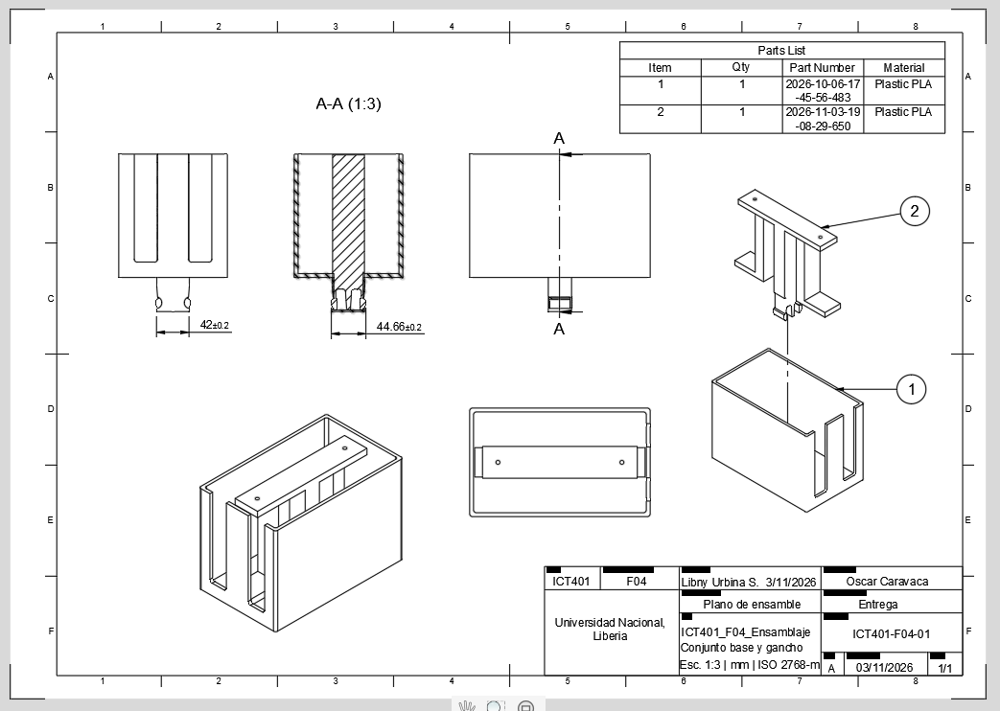
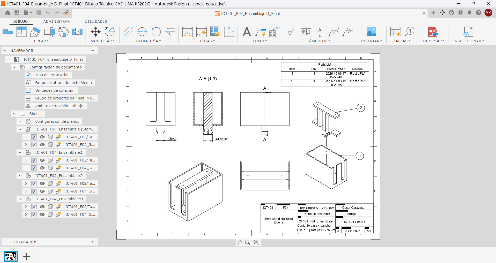
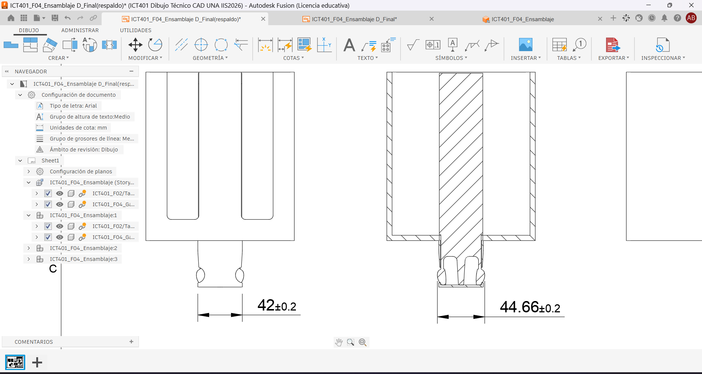

# Ficha de registro: Laboratorio Integrador II-B

**Curso:** ICT401 – Dibujo Técnico Asistido por Computadora
**Semana:** 16
**Laboratorio:** Integrador II-B
**Valor del laboratorio:** 10 %
**Estudiante o equipo:** 3WX
**Proyecto:** Organizador de Cables – Encaje Rápido
**Fecha:** 05 de noviembre de 2026
**Versión inicial:** ICT401_F04_Ensamblaje D_Final
**Versión evaluada:** ICT401_F04_Ensamblaje D_Final(respaldo)

## Propósito y alcance

Esta ficha registra la evidencia del Laboratorio Integrador II-B: integración del modelo, ensamblaje, documentación, exportaciones, tolerancias introductorias y control dimensional básico.

La ficha **no sustituye la entrega de la Fase 4 del Proyecto Integrador**, cuyo valor oficial es 7 % y cuyos requisitos se definen en su propia rúbrica. Algunas evidencias pueden reutilizarse si cumplen ambos propósitos, pero deben conservarse separados el registro del laboratorio y la entrega de la fase.

No se evalúan mediante esta ficha la fabricación física, la metrología avanzada, los procesos completos de manufactura ni la presentación final de la Semana 17.

## Instrucciones

1. Complete la ficha durante las cuatro lecciones.
2. Registre la versión exacta del proyecto utilizada.
3. Conserve una copia de respaldo antes de modificar o exportar.
4. Registre el propósito, formato y comprobación de cada archivo de salida.
5. No invente tolerancias cuando no estén indicadas.
6. Cada medición debe incluir característica, unidad, método y limitación.
7. Use nombres o rutas verificables para las evidencias.

Los textos que comienzan con **Ejemplo:** muestran el nivel de detalle esperado. Sustitúyalos por los datos reales de su proyecto; no los copie como resultados propios.

### Ruta general en Fusion

1. Abra el **Data Panel**, localice el proyecto y abra el diseño vigente.
2. En el **Browser**, confirme componentes, cuerpos y el componente raíz.
3. Revise **Document Settings > Units** y anote las unidades activas.
4. Para el plano, abra el **Drawing** correspondiente y revise sus hojas.
5. Para medir, utilice **Inspect > Measure** y seleccione caras, aristas, puntos o diámetros.
6. Para exportar, utilice **File > Export** cuando el formato esté disponible. Para STL, seleccione el cuerpo o componente y use **Save As Mesh**.
7. Si una orden tiene otro nombre, use el buscador de comandos y registre la orden equivalente.

## Lección 1. Auditoría del proyecto y documentación

| Elemento | Registro |
|---|---|
| Archivo o enlace principal |   ICT401_F04_Ensamblaje D_Final |
| Versión revisada |  ICT401_F04_Ensamblaje D_Final |
| Fecha de la versión |`03-11-2026` |
| Unidades del proyecto |`mm`|
| Plano o Drawing utilizado |  ICT401_F04_Ensamblaje D_Final |
| Ensamblaje utilizado, si corresponde | ICT401_F04_Ensamblaje|
| Lista básica de componentes, si corresponde | Base / Gancho (P01)  y  Tapa (P02) |
| Ubicación del respaldo inicial |  ICT401_F04_Ensamblaje D_Final0(respaldo)  |
| Problema prioritario encontrado |Verificar que la fecha del plano y la versión del modelo coincidan con la versión actual almacenada en Fusion 360 |

### Revisión de coherencia

| Control | Sí | No | N.A. | Evidencia o corrección |
|---|:---:|:---:|:---:|---|
| El modelo y la documentación corresponden a la misma versión. | x |  |  |Ambos muestran la identificación F04. |
| El plano contiene las vistas, cotas y datos que corresponden. | x |  |  | Se observan vistas isométricas, sección A-A y cotas (42 ±0.2 y 44.66 ±0.2). |
| El cajetín o identificación está completo según la plantilla. | x |  |  | Incluye curso, fase, título, autor, fecha, escala y número de plano. |
| La lista coincide con el ensamblaje, cuando corresponde. | x |  |  | La Parts List muestra 2 ítems y el dibujo identifica los componentes 1 y 2. |
| La orientación y la escala son coherentes. | x | |  | Escala 1:3 y unidades en mm. |

**Captura del estado inicial:** 

**Corrección prioritaria antes de exportar:** guardar una versión de respaldo

## Lección 2. Exportaciones y comprobación de archivos

En Fusion, seleccione primero el objeto correcto en el **Browser**. No exporte todo el proyecto si solo se solicita una pieza o un componente.

| Formato | Propósito | Configuración relevante | Archivo generado | Comprobado |
|---|---|---|---|:---:|
| STL | Impresión 3D de las piezas del ensamblaje | Save As Mesh, unidades mm, refinamiento medio| N.A | [ N.A |
| STEP | Intercambio de geometría 3D entre programas CAD |  File > Export > STEP, ensamblaje seleccionado| N.A | N.A |
| DXF | Intercambio de perfiles 2D | Exportar sketch o vista correspondiente| ICT401_F04_Ensamblaje D_Final(respaldo).DXF | X |
| PDF | Documentación técnica del plano | Exportar Drawing, escala 1:3, unidades mm | ICT401_F04_Ensamblaje D_Final(respaldo).PDF | X |

Marque `N.A.` cuando un formato no corresponda al proyecto y justifique la decisión.

JUSTIFICACION: Los formatos STL y STEP se marcaron como N.A. porque el proyecto está orientado únicamente a la generación de documentación técnica y archivos de intercambio 2D (PDF y DXF). No se contempla fabricación mediante impresión 3D ni intercambio de modelos sólidos 3D.

### Comprobación de cada salida

| Archivo | Geometría | Unidades | Escala/orientación | Versión | Ubicación | Resultado |
|---|:---:|:---:|:---:|:---:|---|---|
| ICT401_F04_Ensamblaje D_Final(respaldo).PDF| x | x | x | x | Proyectos/Ashley Blanco | Plano legible con vistas, sección A-A y lista de piezas|
| ICT401_F04_Ensamblaje D_Final(respaldo).DXF  | x | x | x | x | Proyectos/Ashley Blanco | Versión almacenada correctamente |

**Archivo o captura de comprobación:** 

**link de la exportacion:** https://github.com/Ash-BlancoS/ICT401-Portafolio/blob/main/Portafolio/Semana%2016/ICT401_F04_Ensamblaje%20D_Final(respaldo).pdf

**Discrepancia encontrada:**  ninguna
**Corrección aplicada:**  ninguna

## Lección 3. Tolerancias y control dimensional básico

En Fusion, la ruta de comprobación es **Design > Inspect > Measure**. En el resultado de la medición deben poder reconocerse la geometría seleccionada y la unidad.

No agregue una tolerancia que no esté indicada en el plano, la rúbrica o la instrucción correspondiente.

| Característica | Dimensión nominal | Tolerancia | Límite inferior | Límite superior | Valor observado | Unidad |
|---|---:|---:|---:|---:|---:|---|
| Profundidad del clip de la tapa | 42 | ±0,2 | 41,80 | 42,20 | 42| mm |
| Profundidad del clip de la base |44,66  |  ±0,2 | 44,46| 44,86 | 44,66 | mm  |

### Método y resultado

| Característica | Herramienta o método | Resultado | Limitación de la comprobación |
|---|---|---|---|

| Profundidad del clip de la tapa | Inspect > Measure, distancia entre aristas | Conforme  | La verificación se realizó sobre el modelo digital |
| Profundidad del clip de la base| Inspect > Measure, distancia entre aristas | Conforme  | La verificación se realizó sobre el modelo digital |

**Ejemplo de cálculo, si corresponde:**

**Captura o referencia de la medición:** 

**¿Qué valor o criterio no pudo comprobarse?**ninguna

## Lección 4. Integración y cierre del laboratorio

Después de corregir, guarde la versión evaluada desde **File > Save** o la orden equivalente. Compruebe que el archivo exportado y la ficha se refieran a esa misma versión.

### Correcciones finales

| Problema | Acción aplicada | Resultado | Evidencia |
|---|---|---|---|
| Se consideraban exportaciones STL y STEP que no forman parte de los entregables del proyecto | se marcó STL y STEP como N.A., justificando que el proyecto no está destinado a impresión 3D ni al intercambio de modelos 3D | La tabla de exportaciones quedó alineada con los entregables solicitados (PDF y DXF)|  ICT401_F04_Ensamblaje D_Final(respaldo).PDF  |

### Checklist del Laboratorio II-B

- [x ] La versión del modelo y la documentación coincide.
- [ x] El plano final fue revisado.
- [ x] La lista básica coincide con el ensamblaje, cuando corresponde.
- [ x] Cada archivo exportado tiene un propósito registrado.
- [ x] Las salidas fueron revisadas fuera del comando de exportación.
- [ x] Se registraron unidades, escala, orientación y versión.
- [ x] Se realizó al menos una comprobación dimensional básica.
- [ x] Las tolerancias introductorias fueron interpretadas sin inventar valores.
- [ x] Se registraron discrepancias y correcciones.
- [ x] La versión evaluada fue respaldada.
- [ x] La ficha está completa.

### Evidencias finales del laboratorio

| Evidencia | Nombre o ruta | Completa | Observaciones |
|---|---|:---:|---|
| Estado inicial y auditoría | https://github.com/Ash-BlancoS/ICT401-Portafolio/blob/main/Portafolio/Semana%2016/ICT401_F04_Ensamblaje%20Drawing.pdf | [ x] | Incluye revisión de versión, unidades y documentación. |
| Exportaciones y comprobación | https://github.com/Ash-BlancoS/ICT401-Portafolio/tree/main/Portafolio/Semana%2016 | [x ] |  Se verificaron las exportaciones PDF y DXF.|
| Control dimensional | https://github.com/Ash-BlancoS/ICT401-Portafolio/blob/main/Portafolio/Semana%2016/evidenciasS16_E3_Control_Dimensional.png | [x ] | Se comprobaron las dimensiones con tolerancia indicadas en el plano. |
| Plano final o documentación | https://github.com/Ash-BlancoS/ICT401-Portafolio/blob/main/Portafolio/Semana%2016/ICT401_F04_Ensamblaje%20D_Final(respaldo).pdf | [x ] |Documento final revisado y legible.  |
| Lista básica, si corresponde | https://github.com/Ash-BlancoS/ICT401-Portafolio/blob/main/Portafolio/Semana%2016/evidenciasS16_Lista%20de%20piezas.png | [x ] |Coincide con los 2 componentes del ensamblaje.|
| Archivo de respaldo | https://github.com/Ash-BlancoS/ICT401-Portafolio/blob/main/Portafolio/Semana%2016/ICT401_F04_Ensamblaje%20D_Final(respaldo).pdf | [ x] | Respaldo guardado antes de la entrega. |
| Ficha completa | https://github.com/Ash-BlancoS/ICT401-Portafolio/blob/main/Portafolio/Semana%2016/S16_Registro_Laboratorio_II-B_Blanco_Ashley.md | [x ] |Incluye todas las secciones requeridas.  |

## Separación de la Fase 4

**¿Qué producto o archivo adicional exige la rúbrica de la Fase 4?**
PDF y DXF

**¿Qué evidencia de esta ficha puede reutilizarse en la Fase 4?**
el control dimensional y la verificación de la documentación técnica.

**¿Qué requisito de la Fase 4 todavía no está cubierto por esta ficha?**
ninguna, la fase 4 ya fue entrgada

## Cierre reflexivo

**¿Qué exportación requirió más comprobación y por qué?**
-La exportación en PDF, porque fue necesario verificar que las vistas, cotas, escala, cajetín y lista de componentes coincidieran correctamente con el modelo del ensamblaje y fueran legibles.

**¿Qué diferencia encontró entre el valor nominal, la tolerancia y el valor observado?**
-El valor nominal es la medida objetivo indicada en el plano, la tolerancia define el rango aceptable de variación y el valor observado es la medida obtenida mediante la herramienta de inspección.

**¿Qué corrección mejoró la confiabilidad del producto técnico?**
-La verificación de que el plano, la lista de componentes y las exportaciones correspondieran a la misma versión F04 del proyecto.

**¿Qué limitación debe comunicar antes de considerar terminada la Fase 4?**
-No se realizó validación física de una pieza fabricada, por lo que el cumplimiento dimensional solo fue confirmado dentro del entorno de diseño.
